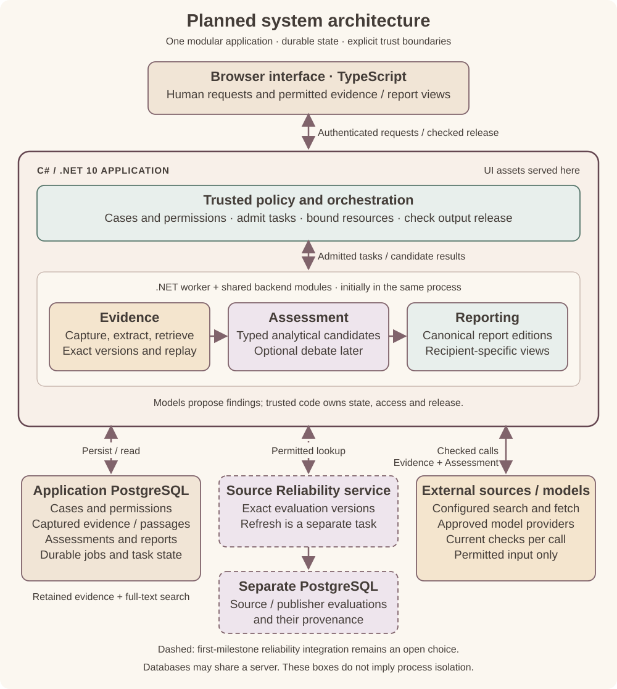

# Planned architecture

FactHarborDSS is in planning. The diagram shows the selected design, not an implemented or validated system.

*Open the diagram for a larger view. Components show responsibilities, not security isolation. Original diagram; repository-wide licensing remains undecided.*

## Core design

- **One application:** a TypeScript interface served by C#/.NET 10, with a worker initially running in the same process.
- **Traceable evidence:** PostgreSQL stores captured web content, source versions, assessments, reports and durable jobs. Full-text search provides the retrieval baseline.
- **Repeatable evidence basis:** reassessment uses the saved version without hidden fetching. Refreshes create new versions; model outputs may still differ.
- **Separate source evaluation:** Source Reliability has its own service interface and database. Its role in the first milestone remains undecided.
- **Permissions enforced in code:** access, report release and external actions are checked separately. Retrieved documents and AI assessments cannot grant authority; source restrictions also apply to derived reports.

The first milestone focuses on web evidence and minimal claim assessment. Broader decision workflows, working-agent access and controlled external actions come later. The [pipeline](Pipeline.md) explains the broader assessment and agent-debate design.

## Planning documents

This repository's [project concept](Concept.md) and [analysis pipeline](Pipeline.md) complement this architecture overview. Agreed contributions need concrete requirements and acceptance criteria supplied alongside their scope.
