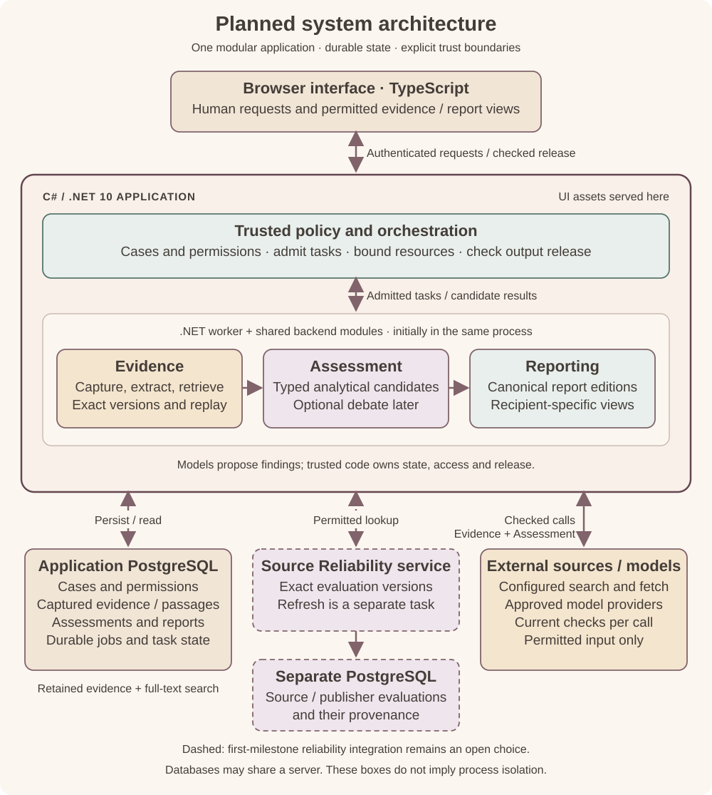
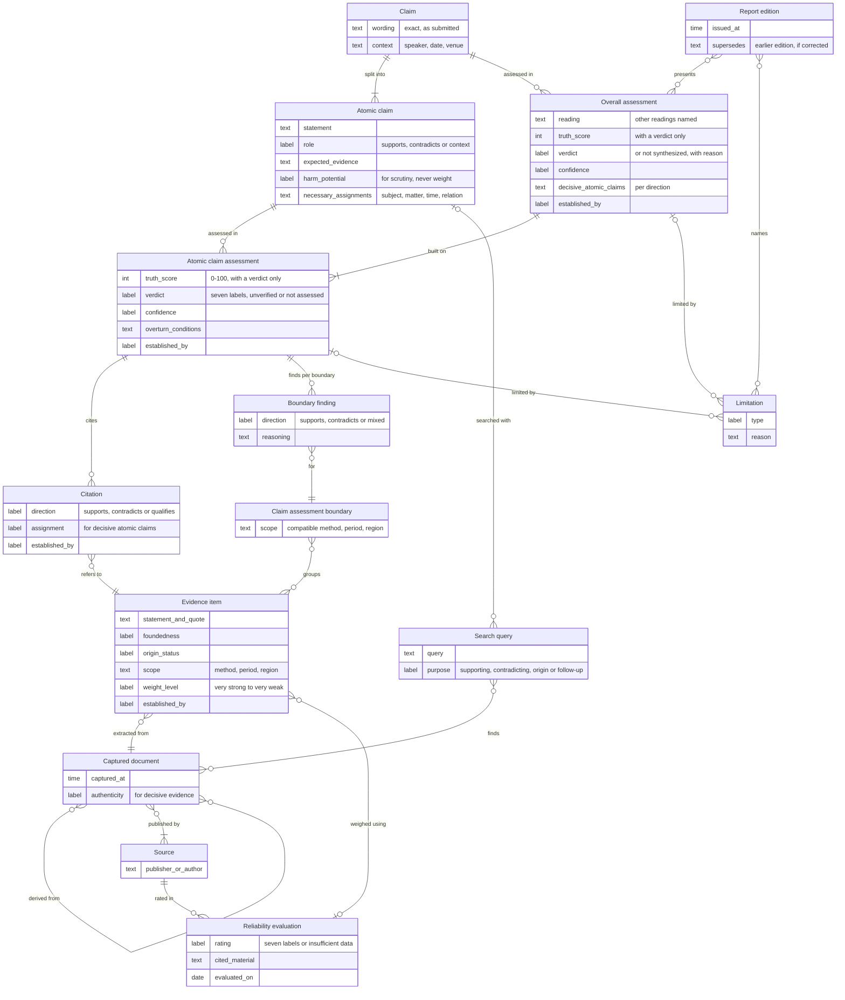

# Planned architecture

FactHarborDSS is in planning. The diagrams show the selected design, not an implemented or validated system.

*Open the diagram for a larger view. Components show responsibilities, not security isolation. Technical users would call the same application API; the diagram shows the browser path only. Original diagram; repository-wide licensing remains undecided.*

## Core design

- **One application:** a TypeScript interface served by C#/.NET 10, with a worker initially running in the same process.
- **Traceable evidence:** PostgreSQL stores captured web content, source versions, assessments, reports and durable jobs. Full-text search provides the retrieval baseline.
- **Repeatable evidence basis:** reassessment uses the saved version without hidden fetching. Refreshes create new versions; model outputs may still differ.
- **Separate source evaluation:** Source Reliability has its own service interface and database. Its role in Stage 1 remains undecided.
- **Permissions enforced in code:** access, report release and external actions are checked separately. Retrieved documents and AI assessments cannot grant authority; source restrictions also apply to derived reports.

Stage 1 focuses on claim checking with public web sources and saved evidence. From Stage 1 on, technical users such as AI agents acting for a responsible person would get the same functions as people through the same API as the browser interface; confirmations, permissions and approvals stay with people. Broader decision workflows and controlled external actions come later. The [pipeline](Pipeline.md) explains the broader assessment and agent-debate design.

## Core data model

Like the FactHarbor Alpha, DSS splits a claim into atomic claims, statements that can each be checked on their own, and gives each one its own assessment. The overall assessment builds on these. Assessments cite evidence items that quote exact passages in captured documents, and evidence with a compatible scope can be grouped into claim assessment boundaries. Every judgment records how it was established, and the report names gaps as limitations. The [principles](Requirements.md) set out the rules these records serve.

*Simplified conceptual model of the planned design, not a database schema. Read each line as a sentence, for example "a claim is split into one or more atomic claims". At a line end, a bar means one, a crow's foot many and a circle zero.*

## Planning documents

[How it would work](Concept.md), the [principles](Requirements.md) and the [analysis pipeline](Pipeline.md) complement this architecture overview. We supply detailed requirements and acceptance criteria with each agreed piece of work.
