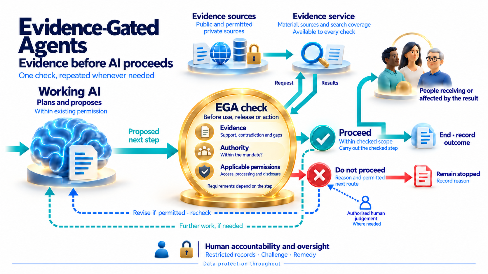

# Our AI Charter and Evidence-Gated Agents

Our AI Charter is a public initiative proposing a trustworthy AI network for free, fair and resilient societies. It supplies the wider accountability context for the DSS direction. Its network and assurance structures remain proposals; they are not operational services or certification claims.

## Five connected pillars

The Charter organizes its work around five pillars:

1. **Accountable AI decisions and actions** — evidence, authority and inspectable outcomes for consequential steps. Evidence-Gated Agents is the current focus within this pillar.
2. **Open, plural models** — meaningful choice across models, languages and regions.
3. **Data and provenance commons** — documented sources, rights, restrictions and access conditions.
4. **Shared assurance and evaluation** — independent examination, review, correction and remedy.
5. **Federated public AI infrastructure** — independently operated capacity connected through shared rules.

[Read the Charter's five-pillar overview](https://robertschaub.github.io/our-ai-charter/). The pillars describe complementary responsibilities, rather than capabilities already implemented in DSS.

## What an EGA check would do

A working AI proposes an exact next step. The EGA concept examines the evidence for that step, its authority and the applicable access, processing and disclosure permissions. A permitted step proceeds within its checked scope; otherwise it remains stopped with a recorded reason. Authorized human judgment is involved where needed.

*Concept illustration by Robert Schaub and contributors, CC BY-SA 4.0. [Original illustration](https://robertschaub.github.io/our-ai-charter/Published/evidence-gated-agents-before-we-rely-illustrated.png). Open the image for a larger view; see [credits](Credits.md).*

Evidence alone grants no permission. A recommendation, permission to disclose that recommendation and authority to execute an external action are separate. Revisions require a new check where applicable; uncertainty about whether an action occurred requires reconciliation, not automatic repetition.

## What exists and what remains

The public EGA work defines the concept and prototype direction. The separate AI Charter Runtime is runnable but unfinished, with simulated scenarios and local test effects. Neither establishes a completed DSS integration.

DSS is intended to provide a shared evidence and assessment core for humans and working AI agents. Its first development milestone is narrower: human-facing web evidence capture/replay and minimal claim assessment. Working-agent access and action integration remain later in the [roadmap](Roadmap.md).

[Explore EGA](https://robertschaub.github.io/our-ai-charter/Assurance/Concepts/evidence-gated-agents/) · [Runtime proof of concept](https://github.com/robertschaub/ai-charter-runtime) · [Published articles](https://robertschaub.github.io/our-ai-charter/Published/)
