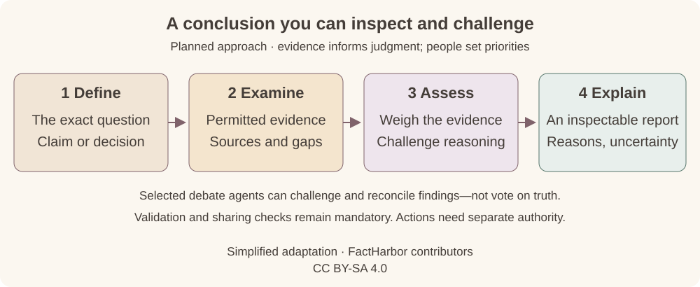

# What FactHarborDSS would do

FactHarborDSS is intended to turn a question into a conclusion whose evidence and reasoning people can inspect.

| Use | The question it helps answer |
|---|---|
| **Check a factual claim** | What supports or contradicts this claim, and how confident can we be in the assessment? |
| **Compare options — later** | Which course of action is justified by the evidence, given the person's confirmed goals and constraints? |

## From question to an inspectable report

*Broader planned approach, not delivered functionality. Additional-agent debate and decision comparison are later scope. [Full pipeline and agent roles](Pipeline.md) · [Diagram credits](Credits.md#analysis-pipeline).*

## What the reader should gain

- **An inspectable basis:** the sources and passages actually examined.
- **A reasoned assessment:** supporting evidence, objections and unresolved gaps.
- **An honest result:** clear scope, uncertainty and limitations—including when no conclusion is justified.

For decisions, people set the priorities. A recommendation does not itself authorize sharing information or taking action.

## Start small, demonstrate usefulness

The first phase focuses on public-web claims and saved evidence that can be reassessed. Comparative evaluation would follow; file-based decision support comes later. DSS must demonstrate benefit against existing tools and workflows.

See the [roadmap](Roadmap.md), [planned architecture](Architecture.md), or [ways to cooperate](Cooperation.md).
