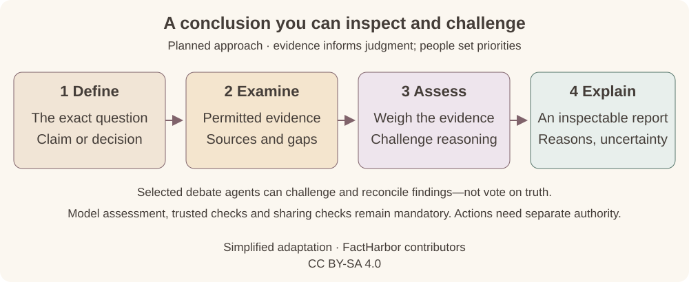

# How FactHarborDSS would work

FactHarborDSS is intended to turn a question into a conclusion whose evidence and reasoning people can inspect.

| Use | The question it helps answer |
|---|---|
| **Check a factual claim** | What supports or contradicts this claim, and how confident can we be in the assessment? |
| **Compare options — later** | Which course of action is justified by the evidence, given the person's confirmed goals and constraints? |

## From question to an inspectable report

*Broader planned approach, not delivered functionality. Additional-agent debate and decision comparison are later scope. [Full pipeline and agent roles](Pipeline.md).*

*Simplified adaptation of the FactHarbor/DSS design. Attribution: FactHarbor contributors · [CC BY-SA 4.0](https://creativecommons.org/licenses/by-sa/4.0/) · [Public visual lineage](https://robertschaub.github.io/FactHarbor/diagrams/homepage-method.svg).*

A claim is split into atomic claims, statements that can each be checked on their own. Each atomic claim is assessed with its own evidence and verdict, and the overall verdict builds on the decisive ones.

## What the reader should gain

- **An inspectable basis:** the sources and passages actually examined.
- **A reasoned assessment:** supporting and contradicting evidence, objections and unresolved gaps, for each atomic claim and overall.
- **An honest result:** clear scope, uncertainty and limitations, including when no conclusion is justified.

For decisions, people set the priorities. A recommendation does not itself authorize sharing information or taking action.

The [principles](Requirements.md) set out the commitments behind this, and the [home page](index.md#planned-stages) lists the planned stages.
