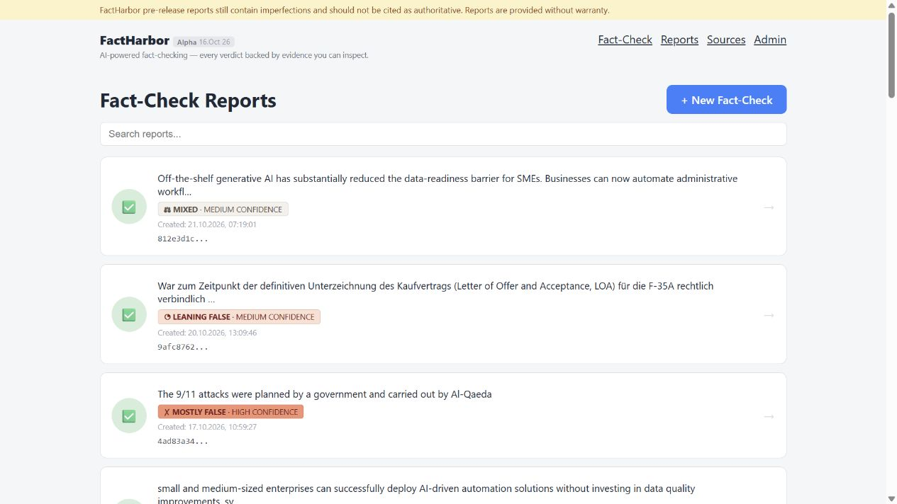

# FactHarbor application

The existing FactHarbor application (Alpha) checks factual claims and articles and presents reports whose evidence and reasoning can be inspected. It provides a concrete reference for the experience DSS aims to retain and develop further.

**These are Alpha examples, not DSS output or independent validation of the conclusions.** The application is a pre-release system; access may require an invitation.

[Explore the FactHarbor application website](https://factharbor.ch/) · [Open the application](https://app.factharbor.ch/jobs)

## Read the result

A report presents a truth assessment and separate confidence. In the example used in the project presentation, the broad claim concerns whether off-the-shelf generative AI reduces the preparation needed for small-business automation. The report labels that claim **Mixed**, with **Medium confidence**.

The verdict describes the report's assessment of the claim. Confidence describes how well its evidence supports that judgment. Neither label guarantees correctness.

The reports list below shows the selected claim as its first entry, including those Mixed and Medium confidence labels. The evidence matrix in the next section shows part of that report's evidence view.

*Dated Alpha interface screenshot, captured 24 October 2026. Open the image for a larger view. The judgments shown belong to those reports.*

## Inspect the evidence

The next view separates parts of the broader claim and groups evidence within assessment boundaries. Readers can follow a claim to evidence items and then to the original documents.

*From the same presentation example. Colours summarize the report's assessments; counts are evidence items, not votes or measurements of evidence quality.*

*Both screenshots are reproduced unchanged from the project presentation of 26 October 2026. Attribution: FactHarbor and its contributors.*

The inspection questions matter more than a colour or count: Does a source actually support the stated point? Does it apply to this case? Is the evidence independent? What contradicts the conclusion, and what is missing?

[Open the selected Alpha report](https://app.factharbor.ch/jobs/812e3d1c1c5d423ba27b4bb18dee2ff9). Availability and access depend on the application; the dated images above remain illustrations of the interface shown in the presentation.

## What DSS would carry forward

DSS would retain inspectable claims, evidence, sources, limitations and separate certainty concepts. It would add a more explicit basis for preserving and replaying the evidence used in an assessment, and later compare options against human-confirmed goals and constraints.

These are design intentions. A new implementation must demonstrate quality and usefulness rather than inherit them from an Alpha screenshot. See the [purpose and approach](Concept.md) and [planned architecture](Architecture.md).
