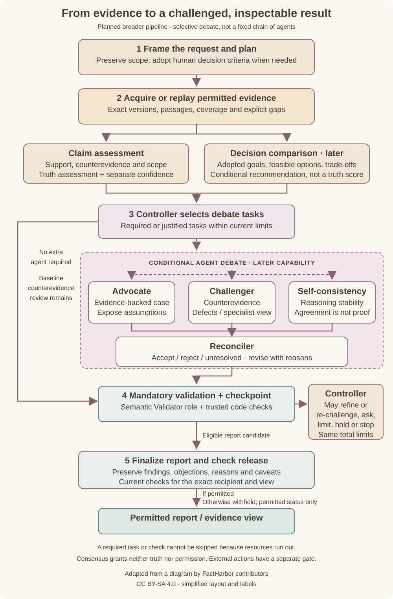

# Analysis pipeline and agent debate

The planned pipeline connects an exact question to permitted evidence, an assessment people can challenge, and a report released to its intended reader. Claim assessment and decision comparison share evidence and reporting, while using distinct analytical methods.

**This is the broader proposed design, not an implemented workflow.** The first milestone remains web evidence capture/replay and minimal claim assessment. Decision comparison and the additional-agent debate route are later scope, subject to evaluation. More agents are not themselves evidence of better results.

*Open the diagram for a larger view. The pink panel contains possible debate tasks; it does not prescribe all roles, parallel dispatch or a fixed number of model calls. The Validator role is represented in step 4 alongside trusted code checks; required validation applies on both routes. [Attribution and reuse notice](Credits.md#analysis-pipeline).*

## What the agents would contribute

The controller selects only required or justified tasks, their dependencies and their permitted inputs. Each task works against the exact evidence and assessment versions it was assigned.

| Task | Contribution |
|---|---|
| Advocate | Explain the evidence-backed case, including assumptions and limitations; do not defend a preferred answer regardless of evidence. |
| Challenger / specialist | Examine counterevidence, alternative explanations, citation or scope defects, or a specific expert question. |
| Self-consistency | Examine instability or contradictions on comparable inputs. Repetition and agreement add no independent evidence. |
| Reconciler | Accept, reject or retain each material objection as unresolved, with reasons; revise affected findings where justified. |
| Validator | Apply the required qualified semantic checks. Trusted code separately checks references, versions, arithmetic and current authority. Validation grants no release or action permission. |

These are task roles, not necessarily five permanent agents or five different models. Different role names do not establish independence. The controller joins only the dependencies it admitted, rejects stale or incompatible results, and retains an explicit outcome for failed or cancelled tasks.

## Challenge without voting or endless retries

Baseline assessment already examines counterevidence. When no extra agent is needed, the direct path still undergoes mandatory checks. A required challenge cannot be skipped because another agent agrees or the budget has run out.

Reconciliation follows the substance of an objection, not the number of agents supporting it. A demonstrated reasoning or quotation defect can justify correction without a new source; unsupported disagreement does not automatically reduce a score. Material unresolved issues constrain the conclusion and its intended use.

The controller can admit useful refinement or request human input within the same remaining resource allowance, or record a limited result, hold or stop. Further rounds do not reset limits. Deliberate scope narrowing or changed decision priorities require the applicable human adoption; a claim-only request needs no irrelevant preference approval.

## From candidate to permitted report

Reports retain material objections, dispositions, changes, reasons, uncertainty and stopping conditions—not raw debate transcripts. Only a valid candidate becomes a fixed report edition. Recipient-specific access, disclosure, quality and any required human review still govern release; a misleading redaction must be withheld.

A report is evidence, not permission to act. External actions have a separate authorization and execution path and are outside this simplified diagram.

See the [system architecture](Architecture.md), [purpose and approach](Concept.md), and [delivery roadmap](Roadmap.md).
