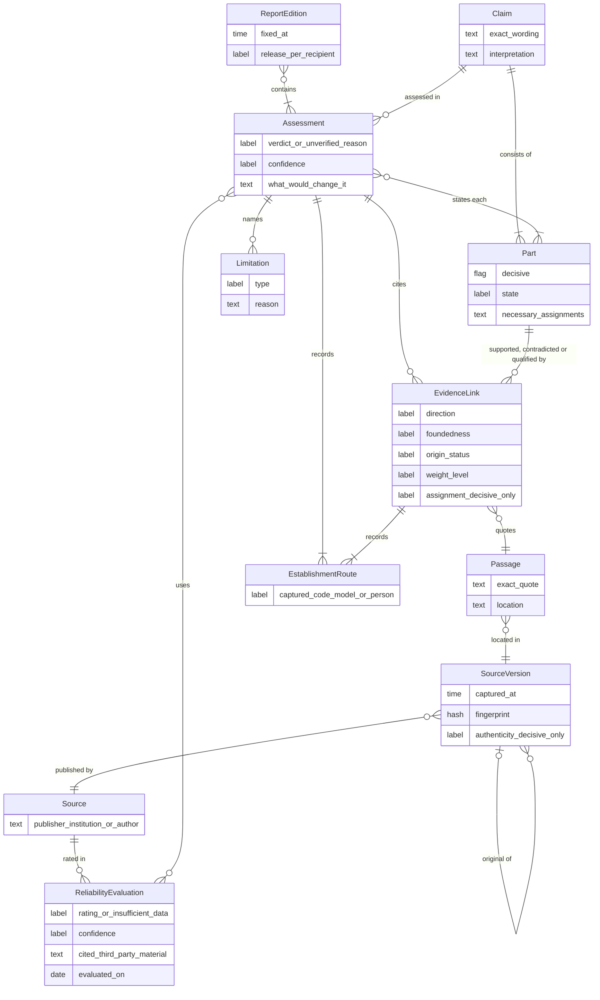

# Key requirements

These are the most important requirements for the planned DSS: what it must and must not do. They are design commitments, not delivered functionality. Early milestones deliver some of them in simplified form, and reports say what was not assessed.

## How the parts fit together

The diagram shows the main objects these requirements refer to in fact-checking. A claim consists of parts; each assessment states every part and cites evidence through links that quote exact passages in captured source versions. Every assessment and evidence link records how it was established, and gaps are named as limitations.

*Simplified conceptual model of the planned design, not a database schema.*

## Results and their meaning

- **Verdict and confidence:** a factual verdict combines a truth score and a readable label with a separate confidence in the assessment. Neither is a calibrated probability.
- **Separate states:** conflicting evidence, insufficient evidence and no assessment are distinct outcomes. An unverified result states whether the evidence was insufficient or a conflict remained unresolved.
- **Basis and overturn conditions:** each verdict states how well the evidence supports it and names the evidence or finding that would change it.
- **Decisive parts:** a true or mostly true verdict requires the parts decisive for it to be supported, and a false or mostly false verdict requires the parts decisive for it to be contradicted; which parts are decisive is itself a model judgment. In fact-checking, if a verdict still contradicts this after one correction attempt, the report marks the contradiction.

## How each result was established

- **Recorded routes:** each result records every way it was established: captured, checked by trusted code, judged by a model, or reviewed or adopted by a person. Only trusted-code or human checks are called checked, validated or verified, and a verdict is labelled as a model judgment.
- **No check by agreement:** when a model assesses another model's output, the result is still a model judgment. Agreement among models, roles or repeated runs never counts as a check.
- **Correct assignment:** an authentic source does not show that a passage concerns the right subject, matter, time and relation. For the parts a verdict rests on, these stay model judgments until a person checks them, and open ones are named.
- **Recorded basis:** each assessment records the interpretation of the question or claim, the key details considered, the evidence capture dates, and the versions of the assessment schema and scale.

## Evidence

- **Search results are candidates:** a retrieved document counts as evidence only after it has been assessed.
- **Evidence assessed before it counts:** the model first assesses whether each cited document substantiates its statement, for example with data, method or checkable sources, and whether it is the original source. Unfounded material is not counted as evidence and is named in the report. For evidence a verdict rests on, the original source is sought and assessed within the run's search allowance; if it is not found or not sought, the report says so.
- **Weighed, not counted:** the model gives each cited evidence item a reasoned weight level, from very strong to very weak (not considered), based on its documentation, origin, independence and the reliability of its source. No numeric weights, scores or formulas apply. The model rates source reliability from cited third-party material, such as fact-checks, correction records and ownership, never from its recollection; insufficient data is a separate result, not a low rating. These assessments are shown to readers. Where no source-reliability evaluation is available, reliability is shown as not assessed.

## Consistency of judgments

- **Repeated runs:** if runs are repeated on the same captured evidence, the verdict is never set by picking a favorable run, rerunning until runs agree, or voting or averaging. A single run means stability is not measured. Whether and how run variation is shown is decided after reader testing.
- **Separate measures:** evidence sufficiency and any observed run variation stay separate and are never merged into one score. Run variation is also kept apart from the verdict and its confidence. A model's stated confidence always comes with its evidence-based reasons, is not a calibrated probability and never establishes correctness on its own.

## Gaps and limits

- **Named limits instead of stops:** in fact-checking, uncertainty, missing or conflicting evidence and parts that could not be assessed are named in the report instead of stopping the analysis; access, disclosure and release checks still apply.
- **Missing steps:** a required task or check that cannot run is named as missing, never silently skipped; fact-checking continues with the gap shown, and other analyses are held or limited.

## Decisions (later stage)

- **People set the basis:** goals, constraints and priorities are confirmed by the responsible person.
- **Open points:** the report names open decisive points as questions for the person deciding; possible consequences of an error are stated only where evidence supports them. Urgency never waives a required check.
- **No authority from evidence:** a report is evidence, not permission to act. Disclosure, release and external actions are authorized separately.

## People and software

- **Same functions through an API:** technical users, such as other software and working AI agents acting for a responsible person, get the same functions as people, with their own identity and never more rights. Confirming goals and approving actions stay with people.

## Evaluation

- **Before ordinary use:** methods must pass independent evaluation against reference judgments by competent reviewers. Until then, results are labelled as coming from an unqualified method.
- **Method, not the single case:** measured agreement with independent reviewers describes the method, not an individual verdict.
- **Effort:** evaluation also measures whether DSS makes human checking faster and more complete.

See the [analysis pipeline](Pipeline.md) for how these requirements fit into the planned workflow.
