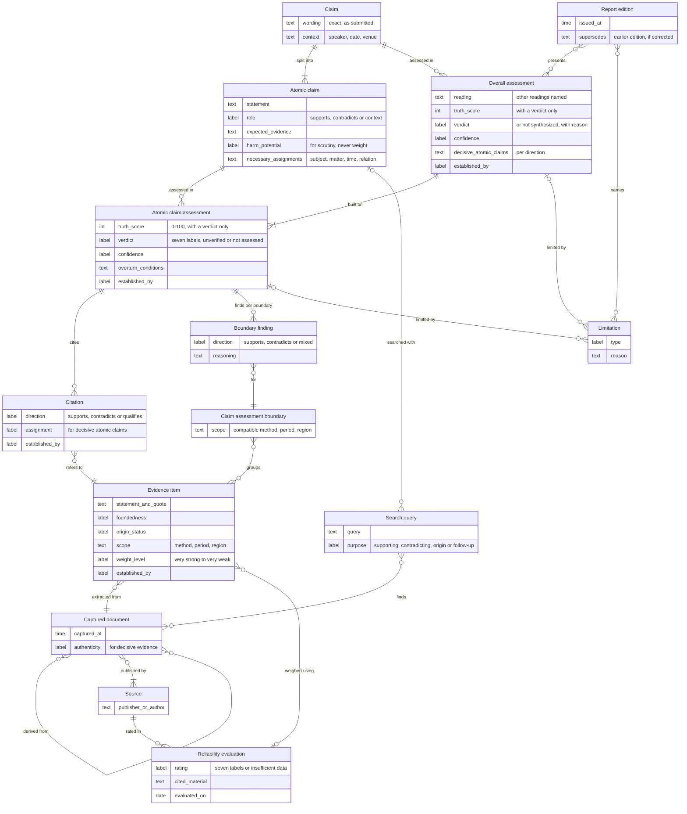

# Key requirements

These are the most important requirements for the planned DSS: what it must and must not do. They are design commitments, not delivered functionality. Which of them Stage 1 covers, and in what form, is set when it is scoped; reports say what was not assessed.

## Main records and how they relate

Like the FactHarbor Alpha, DSS splits a claim into atomic claims, statements that can each be checked on their own, and gives each one its own assessment. The overall assessment builds on these. Assessments cite evidence items that quote exact passages in captured documents, and evidence with a compatible scope can be grouped into claim assessment boundaries. Every judgment records how it was established, and the report names gaps as limitations.

*Simplified conceptual model of the planned design, not a database schema. Read each line as a sentence, for example "a claim is split into one or more atomic claims". At a line end, a bar means one, a crow's foot many and a circle zero.*

## Results and their meaning

- **Atomic claims first.** A claim is split into atomic claims; a simple claim is one atomic claim, whose verdict is then also the overall verdict. Each atomic claim gets its own verdict, confidence, reasoning and cited evidence. The overall verdict is a separate judgment built on the atomic claims decisive for it; it never averages their verdicts or counts how many are supported. Where no overall verdict is justified, the report says so and the atomic-claim verdicts stand.
- **Verdict and confidence.** A factual verdict combines a truth score from 0 (false) to 100 (true), set by model judgment, with the readable label that fixed rules assign to it, and a separate confidence explained by the evidence and the completeness of the search. Neither is a calibrated probability, and no formula derives them from weight levels, reliability labels or item counts.
- **Separate states.** Mixed is a supported middle result: the evidence shows the claim to be about as much true as false. Unverified means that no adequately supported judgment was reached, for a stated reason: insufficient evidence or an unresolved conflict. A claim that could not be assessed, or an assessment that failed or did not run, is a separate state. Finding no evidence never produces False or a midpoint score.
- **Reading and scope.** The original wording is kept. An ambiguous claim is assessed in its most plausible reading, with its own qualifiers neither strengthened nor weakened; other material readings and atomic claims that were not assessed are named. Opinions and value judgments get no truth verdict and are named as not assessable. A literally accurate but misleading claim keeps its factual verdict, and the misleading framing is explained separately.
- **Basis and overturn conditions.** Each verdict states how well the evidence supports it and names the evidence or finding that would change it. A true, mostly true, false or mostly false verdict on an atomic claim cites at least one considered evidence item in its direction, or a recorded inference or calculation.
- **Decisive atomic claims.** A true or mostly true overall verdict requires each atomic claim decisive for it to point the same way: true or mostly true if it supports the claim, false or mostly false if it contradicts it; the reverse holds for false or mostly false overall verdicts. Which atomic claims are decisive is itself a model judgment and is shown in the report. In fact-checking, if a verdict still breaks this rule after a correction attempt, it keeps its label but carries a prominent notice naming the atomic claim that is not established.

## How each result was established

- **Each result says how it was established:** captured, checked by trusted code (fixed, tested software rules), judged by a model, or reviewed or adopted by a person. Only checks by trusted code or people are called checked, validated or verified, and a verdict is labelled as a model judgment. A person's check is recorded with their role and covers only what they examined.
- **Agreement is not a check.** When a model assesses another model's output, the result is still a model judgment. Agreement among models, roles or repeated runs never counts as a check.
- **Right subject and context.** A genuine source can still be about something else. Whether an evidence item concerns the same subject, matter, time and relation as the atomic claim stays a model judgment until a person checks it; for decisive atomic claims, open questions are named.
- **Recorded basis.** Each assessment records the reading of the claim, the context of the statement where known (speaker, date and venue), the key details considered, the evidence capture dates, and the versions of the assessment schema and scale.

## Evidence

- **Search in both directions.** For each atomic claim, the search also looks for contradicting evidence. Every search query is recorded with its purpose, and the report says whether a search for contradicting evidence ran. A retrieved document is a candidate; it counts as evidence only after it has been assessed.
- **Evidence assessed before it counts.** The model first assesses whether each cited document substantiates the statement it is cited for, for example with data, method or checkable sources, and whether it is the original source; a record of what someone said shows that it was said, not that it is true. Material that does not substantiate its statement is not counted as evidence and is named in the report; baseless claims such as fabrications are never considered. For evidence a verdict rests on, the original source is sought within the run's search allowance; if it is not found or not sought, the report says so.
- **Weighed, not counted.** Each evidence item gets a reasoned weight level, from very strong to very weak, based on its documentation, origin, independence and the reliability of its source; very weak items are not considered and are named in the report. Items that share an origin count as one basis, not as independent confirmation. The same rules apply to supporting and contradicting evidence. No numeric evidence weights, evidence or source scores, or formulas apply.
- **Scope and claim assessment boundaries.** Each evidence item records the scope of its data, such as method, period and region. Evidence with compatible scopes can be grouped into claim assessment boundaries. Where boundaries lead to different conclusions, the assessment shows a finding for each and explains the difference; each atomic claim keeps one verdict.
- **Source reliability.** Ratings rest on retrieved, cited third-party material, such as fact-checks, correction records and ownership; without such material the result is insufficient data, not a low rating. Where no evaluation is available, reliability is shown as not assessed. These assessments are shown to readers.

## Consistency of judgments

- **Repeated runs:** if runs are repeated on the same captured evidence, the verdict is never set by picking a favourable run, rerunning until runs agree, or voting or averaging. A single run means stability is not measured. Whether and how run variation is shown is decided after reader testing.
- **Separate measures:** evidence sufficiency and any observed run variation stay separate and are never merged into one score. Run variation is also kept apart from the verdict and its confidence. A model's stated confidence always comes with its evidence-based reasons, is not a calibrated probability and never establishes correctness on its own.

## Gaps, limits and corrections

- **Named limits instead of stops:** in fact-checking, uncertainty, missing or conflicting evidence and atomic claims that could not be assessed are named in the report instead of stopping the analysis; access, disclosure and release checks still apply.
- **Missing steps:** a required task or check that cannot run is named as missing, never silently skipped; fact-checking continues with the gap shown, and other analyses are held or limited.
- **Corrections:** an issued report edition is never changed silently. A correction or reassessment creates a new dated edition linked to the earlier one, stating what changed and why; the earlier edition keeps its content and shows that it was superseded.

## Decisions (later stage)

- **People set the basis:** goals, constraints and priorities are confirmed by the responsible person.
- **Open points:** the report names open decisive points as questions for the person deciding; possible consequences of an error are stated only where evidence supports them. Urgency never waives a required check.
- **A basis, not permission:** a report is a basis for decisions, not permission to act. Disclosure, release and external actions are authorized separately.

## People and software

- **Same functions through an API:** technical users, such as other software and AI agents acting for a responsible person, get the same functions as people, with their own identity and never more rights. Confirming goals and approving actions stay with people.

## Evaluation

- **Before routine use:** methods must pass independent evaluation against reference judgments by competent reviewers, with pass criteria set before testing. Until then, results are labelled as coming from a method not yet independently evaluated.
- **Independent reference judgments:** reviewers record their judgments before seeing DSS results, and disagreements are reported, not forced into consensus. Evaluation covers the reading of each claim and its decisive atomic claims as well as verdicts, and compares English and German versions of the same claims.
- **Method, not the single case:** measured agreement with independent reviewers describes the method, not an individual verdict.
- **Effort:** evaluation also measures whether DSS makes human checking faster and more complete.

See the [analysis pipeline](Pipeline.md) for how these requirements fit into the planned workflow.
